# Highway-env Adversarial

基于 [highway-env](https://github.com/Farama-Foundation/HighwayEnv) 的**对抗式自动驾驶测试**项目：用强化学习训练背景车（BV / CBV），主动攻击固定的自车（Ego），评估不同 Ego 策略在危险交互下的安全性。

绿色车 = Ego（自车） · 黄色车 = 被选中的对抗 BV · 蓝色车 = 普通 IDM 背景车

---

## 项目做了什么？

高速公路场景里，普通仿真里的背景车通常很“乖”。本项目让其中一辆最近的前方背景车变成 **AdvVehicle**，用 RL 学会：

- 急刹、贴车、加塞（cut-in）
- 逼迫 Ego 换道或碰撞

从而对 Ego 做压力测试，而不是只测“风平浪静”的驾驶。

| 角色 | 控制方式 | 说明 |
|------|----------|------|
| **Ego** | 固定策略 | IDM 规则车，或预训练 DQN / A2C / PPO |
| **对抗 BV** | Rainbow DQN 或 PPO | 学习制造危险交互 |
| **其余 BV** | IDM | 普通交通流 |

难度档位（easy / medium / hard）通过奖励与风险相关项调节，用于比较不同攻击强度下 Ego 的碰撞率、TTC、换道与 cut-in 行为。

---

## 演示动画（GIF）

GIF 位于 [`image/`](image/)，可直接在仓库里查看。

### DQN-Ego

| 2 车道 · 追尾压迫 | 2 车道 · 侧向碰撞 |
| :---: | :---: |
| 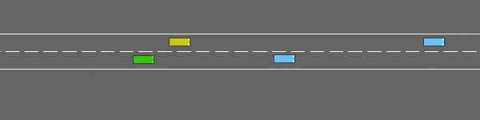 | 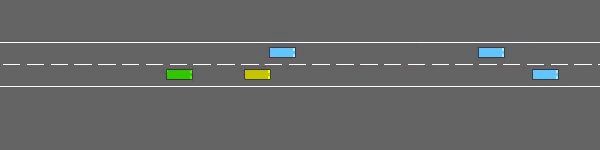 |
| 前方对抗车急刹 / 压迫 | 侧向碰撞 |

| 3 车道 · 紧急换道 | 3 车道 · cut-in |
| :---: | :---: |
| 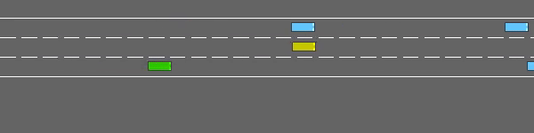 | 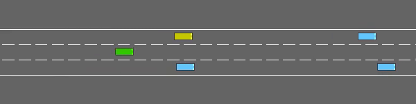 |

### IDM-Ego

| 2 车道 · 碰撞 | 2 车道 · 紧急换道 |
| :---: | :---: |
| 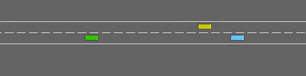 | 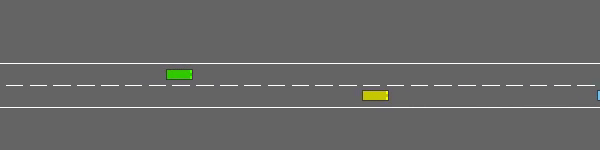 |

| 3 车道 · cut-in | 3 车道 · 周围车碰撞 |
| :---: | :---: |
| 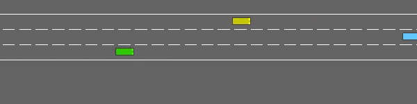 | 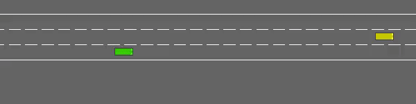 |

### 评估录像（MP4）

精选片段在 [`docs/demo/`](docs/demo/)（点击文件可下载播放）：

| 文件 | 场景 |
|------|------|
| [dqn_hard_lane2_ep0.mp4](docs/demo/dqn_hard_lane2_ep0.mp4) | DQN-Ego · hard · 2 车道 |
| [dqn_hard_lane3_ep0.mp4](docs/demo/dqn_hard_lane3_ep0.mp4) | DQN-Ego · hard · 3 车道 |
| [dqn_easy_lane2_ep0.mp4](docs/demo/dqn_easy_lane2_ep0.mp4) | DQN-Ego · easy · 2 车道 |
| [idm_hard_lane2_ep0.mp4](docs/demo/idm_hard_lane2_ep0.mp4) | IDM-Ego · hard · 2 车道 |
| [ppo_hard_lane2_ep0.mp4](docs/demo/ppo_hard_lane2_ep0.mp4) | PPO-Ego · hard · 2 车道 |

更多原始录像在 `PPO_BV_models/*/videos/`。

---

## 评估结果图

评测矩阵：**3 种 Ego × 3 难度 × 2/3 车道**，每格约 100 个 episode（`evaluation_results/`）。

### Ego 碰撞率热力图

对抗 BV 越“会攻击”，Ego 碰撞率往往越高。下图为 2 车道汇总：

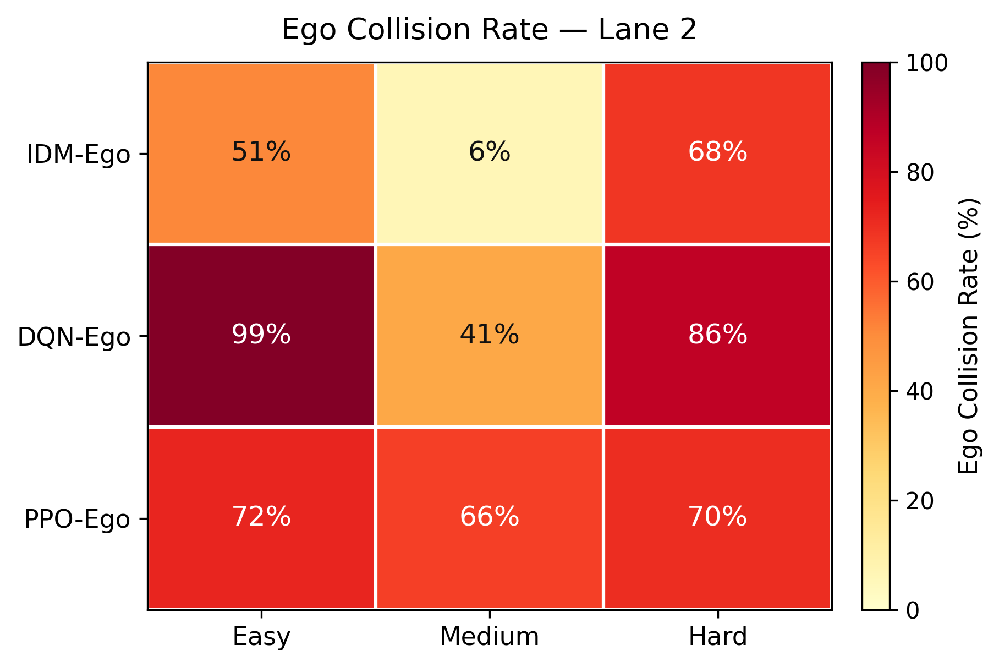

3 车道：

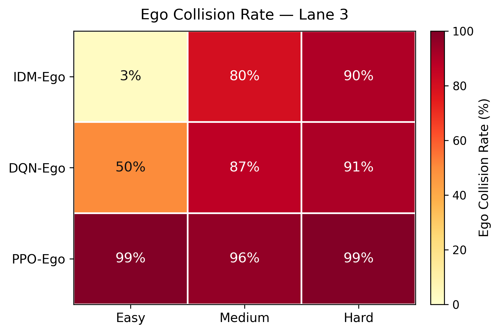

### 行为指标随难度变化

难度升高时，cut-in 与换道更频繁，episode 往往更短（更早碰撞或结束）：

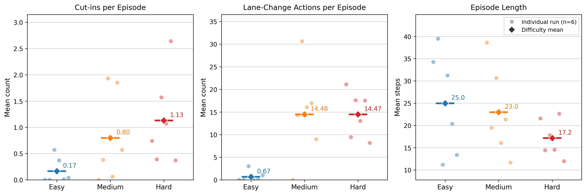

### TTC / 距离 & Ego–BV 碰撞关系

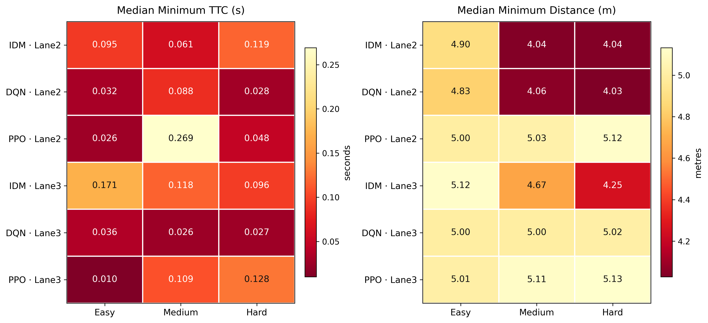

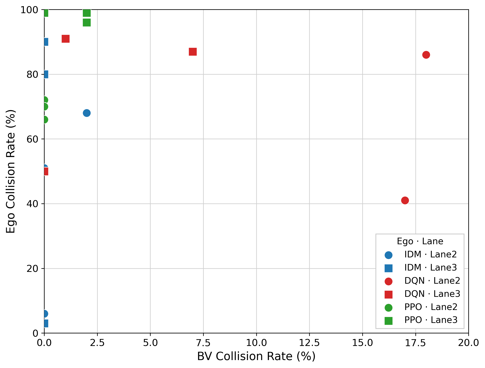

### 训练奖励曲线（Rainbow 管线）


---

## 仓库结构

```
├── Adv_main.py              # Rainbow DQN 对抗 BV：训练 / 测试入口
├── train_bv_ppo.py          # PPO 对抗 BV 训练（独立管线）
├── evaluate_ppo_bv.py       # PPO BV 正式评测（写 CSV）
├── train_ego_adv.py         # 用对抗 BV 反过来训练 Ego（PPO/A2C）
├── config.py                # Ego 路径、动作表、环境默认配置
├── BV_Agent/                # Rainbow DQN 实现
├── Ego_Agent/               # 预训练 Ego 模型与 Trainer
├── highway_env/             # 扩展环境（含 highway-adv-v0）
├── BV_model/                # Rainbow 训练得到的 BV 权重
├── PPO_BV_models/           # PPO BV 权重与评估视频
├── evaluation_results/      # 评测 summary / per-episode CSV
├── image/                   # 演示 GIF 与观测示意
├── docs/figures/            # README 用数据图
├── docs/demo/               # README 用精选 MP4
└── plot_*.py                # 从 CSV 生成热力图 / 行为图
```

观测示意（CBV kinematics）：

<p align="center">
  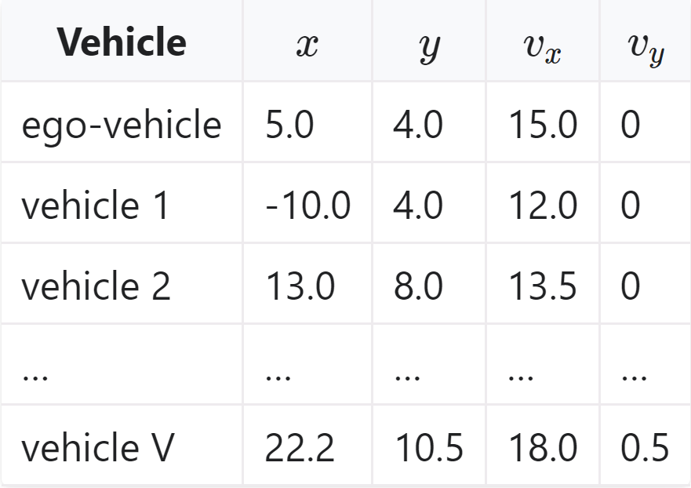
</p>

---

## 环境与安装

需要 **Python 3.10+**，建议使用虚拟环境。

```bash
git clone https://github.com/mirkamilmawlan/Highway-env-adversarial.git
cd Highway-env-adversarial

python -m venv .venv
source .venv/bin/activate   # Windows: .venv\Scripts\activate

pip install .
pip install "stable-baselines3[extra]"
```

核心依赖见包元数据：`gymnasium`、`numpy`、`pygame`、`matplotlib`、`pandas`、`scipy`、`moviepy`、`tensorboardX` 等。

---

## 使用方法

### 1）训练 / 测试 Rainbow 对抗 BV（原管线）

```bash
# 训练（默认 2 车道；可换 Ego：DQN-Ego / A2C-Ego / PPO-Ego / IDM-Ego）
python Adv_main.py --Ego=DQN-Ego --train
python Adv_main.py --Ego=DQN-Ego --train --lane_count=3

# 测试并渲染
python Adv_main.py --Ego=IDM-Ego --test --render
python Adv_main.py --Ego=IDM-Ego --test --render --lane_count=3

# TensorBoard
tensorboard --logdir=AdvLogs
```

可选：自己训练 Ego

```bash
python Ego_Agent/Trainer.py --train --ego_type DQN
```

### 2）训练 PPO 对抗 BV（新管线）

```bash
python train_bv_ppo.py --ego IDM-Ego --risk_level medium --total_timesteps 50000
python train_bv_ppo.py --ego DQN-Ego --risk_level hard --lane_count 3 --seed 17

tensorboard --logdir PPO_BV_logs/
```

### 3）正式评测 PPO BV

```bash
# 冒烟（5 局）
python evaluate_ppo_bv.py \
  --ego DQN-Ego --difficulty hard --lane-count 2 \
  --training-seed 17 --episodes 5 --eval-seed-start 10000

# 完整评测（100 局）
python evaluate_ppo_bv.py \
  --ego DQN-Ego --difficulty hard --lane-count 2 \
  --training-seed 17 --episodes 100 --eval-seed-start 10000
```

结果写入 `evaluation_results/{Ego}/{difficulty}/lane{N}_seed{S}/`。

### 4）从 CSV 重画论文 / PPT 图

```bash
python plot_ego_collision_heatmaps.py
python plot_behaviour_metrics_by_difficulty.py
python plot_median_ttc_distance_heatmaps.py
python plot_ego_vs_bv_collision_scatter.py
python plot.py   # Rainbow 训练奖励
```

### 5）对抗环境下训练 Ego

```bash
python train_ego_adv.py --help
```

---

## 对抗 BV 动作空间

```python
Bv_Action = {
    0: "LANE_LEFT",
    1: "IDLE",
    2: "LANE_RIGHT",
    3: "FASTER",
    4: "SLOWER",
}
```

每帧会在 Ego 前方最近的背景车中选出一辆作为 **selected BV**（黄色），由 RL 策略输出上述高层动作。

---

## 关键说明

- 环境基于 Farama **highway-env**；对抗环境扩展最初见 [CurryChen77/Highway-env-adversarial](https://github.com/CurryChen77/Highway-env-adversarial)。
- 本仓库在此基础上补充了 **PPO BV 训练 / 评测**、**多难度实验矩阵**、**碰撞率与行为分析图**，以及演示视频整理。

---

## License

MIT（与上游包声明一致）。
